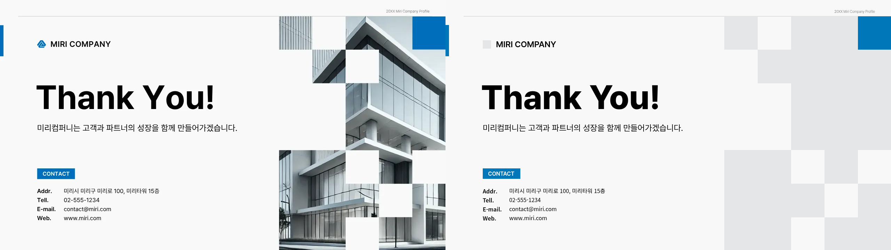
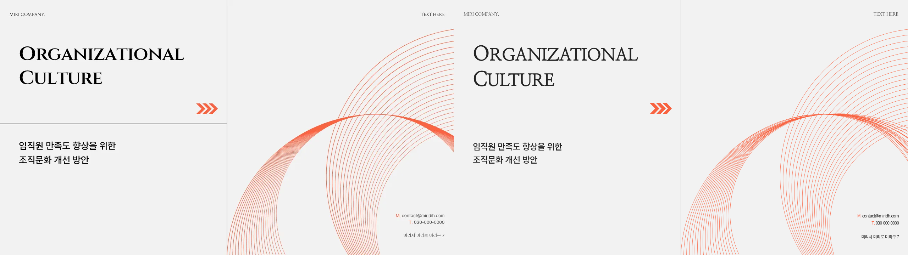
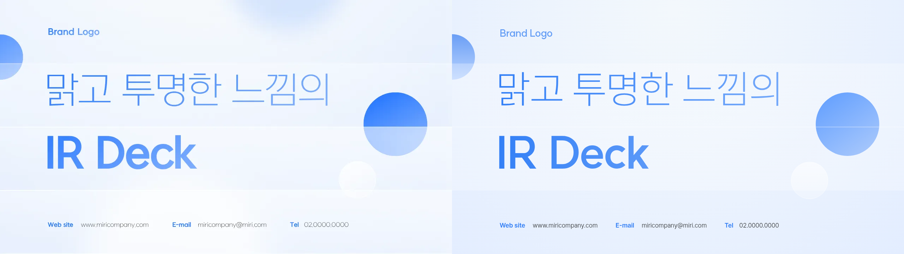
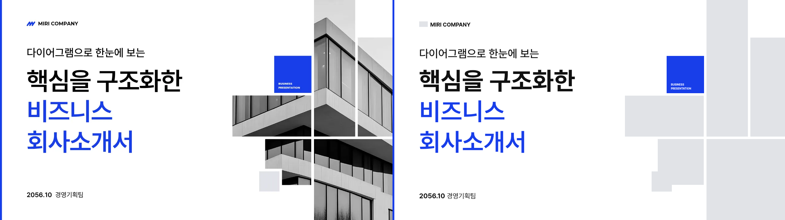

# Rhetis · 기업 덱 045–053

## 전체 비교 PDF

[원본 | 재현본 · 107장](previews/original-vs-replica.pdf) · [원본 | 라이브러리 조립본 · 107장](previews/original-vs-reassembled.pdf)

각 PDF는 덱별 책갈피 6개와 2560×720 나란히 비교 페이지를 포함합니다. 같은 비교 PDF가 각 덱의 검수 ZIP에도 개별로 들어 있습니다.

첨부 ZIP에 실제 포함된 **6개 덱, 107장**을 대상으로 덱당 독립 컬렉션 하나를 제작했습니다. 045번은 제공된 `slide_20.png` 한 장만 포함합니다. 각 컬렉션은 키트 토큰, 페이지 foundation, 계약 요소 56개와 모범 fixture 전부를 포함합니다.

| 컬렉션 | 원본 장수 | 반입용 | 검수용 | 소스·미리보기 |
|---|---:|---|---|---|
| portico-045 | 1 | [컬렉션 ZIP](downloads/portico-045.zip) | [검수 ZIP](downloads/portico-045-review.zip) | [소스](collections/portico-045) · [전체 페이지 미리보기](reviews/portico-045/README.md) |
| cultureweave-046 | 18 | [컬렉션 ZIP](downloads/cultureweave-046.zip) | [검수 ZIP](downloads/cultureweave-046-review.zip) | [소스](collections/cultureweave-046) · [전체 페이지 미리보기](reviews/cultureweave-046/README.md) |
| launchrail-048 | 30 | [컬렉션 ZIP](downloads/launchrail-048.zip) | [검수 ZIP](downloads/launchrail-048-review.zip) | [소스](collections/launchrail-048) · [전체 페이지 미리보기](reviews/launchrail-048/README.md) |
| vitreous-050 | 20 | [컬렉션 ZIP](downloads/vitreous-050.zip) | [검수 ZIP](downloads/vitreous-050-review.zip) | [소스](collections/vitreous-050) · [전체 페이지 미리보기](reviews/vitreous-050/README.md) |
| axisfold-052 | 20 | [컬렉션 ZIP](downloads/axisfold-052.zip) | [검수 ZIP](downloads/axisfold-052-review.zip) | [소스](collections/axisfold-052) · [전체 페이지 미리보기](reviews/axisfold-052/README.md) |
| obelisk-053 | 18 | [컬렉션 ZIP](downloads/obelisk-053.zip) | [검수 ZIP](downloads/obelisk-053-review.zip) | [소스](collections/obelisk-053) · [전체 페이지 미리보기](reviews/obelisk-053/README.md) |

각 검수 ZIP은 재현·조립 HTML/CSS, 페이지별 1280×720 PNG, 원본과 나란히 놓은 2560×720 PNG·비교 PDF, 페이지 PDF, 요소 폴더별 라이트·다크 시트 PNG와 전체 라이브러리 PDF를 포함합니다. `compare-replica/compare-replica.pdf`는 원본 | 재현본, `compare-reassembled/compare-reassembled.pdf`는 원본 | 라이브러리 조립본입니다. 비교 PDF는 슬라이드당 한 페이지이며 2560×720의 나란히 배치를 유지합니다. 요소 시트는 각 fixture의 1280×720 패널을 축소 없이 세로로 이어 붙였습니다. 따라서 시트 높이는 fixture 수에 따라 다르며, PDF에서도 fixture마다 한 페이지를 사용해 작은 글자를 읽을 수 있습니다. 검수용 글꼴과 사용한 컬렉션 복사본을 함께 넣어 상대 경로로 열 수 있게 했습니다. HTTP 서버에서 열어야 브라우저 관리 정책으로 인한 file URL 차단을 피할 수 있습니다.

100MB를 넘는 050 검수 ZIP은 PNG/PDF 품질과 파일 구성을 유지하기 위해 Git LFS로 저장합니다. 브라우저의 다운로드 버튼 또는 최종 검증 기록의 media URL로 ZIP 본문을 받을 수 있습니다. Git으로 복제한 경우에는 Git LFS가 필요합니다.

```bash
python -m http.server 8000
# http://localhost:8000/reviews/<collection>/index.html
python tools/preview.py collections/<collection> contract/type-steps.json --out light.html
python tools/preview.py collections/<collection> contract/type-steps.json --dark --out dark.html
```

계약 미리보기 도구는 원본 그대로입니다. 도구가 만드는 절대 `file:` 글꼴 링크는 HTTP 검수용 시트에서 묶음 안의 상대 경로로만 바꿨습니다. 디자인 CSS를 추가하지 않았습니다.

사진·복잡한 일러스트·이미지 로고는 요청에 따라 연회색 단색 자리로 대체했습니다. 지원 글꼴 중 가장 가까운 것을 실제 로드했고, 읽기 어려운 작은 문구와 원본/조립본 차이는 각 검수 기록에 남겼습니다. 반입용 컬렉션의 색은 팔레트 자리만 정의합니다. 조립본은 원본 색을 비교할 수 있도록 호스트의 스타일 토큰으로 공급하며, 라이브러리 시트는 계약의 기준 팔레트를 사용합니다.

원본과 픽셀 100% 동일하다는 주장은 하지 않습니다. 원본 글꼴 메타데이터가 없어 허용 글꼴 중 실측으로 가까운 글꼴을 선택했고 브라우저의 안티앨리어싱 차이가 남습니다. 최종 승인은 문구·배치·기하·데이터 관계를 개별 비교하고 최신 렌더의 SHA-256에 연결한 검수 기록이며, 자동 검사 0을 시각 동일성으로 해석하지 않았습니다.

모범 구성과 일반 fixture 배치 규칙이 충돌하는 두 callout은 구체적인 모범 구성 지시를 우선해 원본 배치를 보존했습니다. 모범 card fixture 안의 원본 별 모양 문자도 동일 마크업 요구에 따라 보존했으며, 새로 만든 아이콘은 Lucide 자리로 작성했습니다.

[107장 전체 목록 및 계약 대응](inventory.md) · [빌드·렌더·ZIP 검증 결과](validation.json) · [GitHub에서 다시 받은 ZIP 검증](remote-verification.json)

### portico-045



[페이지별 비교와 기록](reviews/portico-045) · [디자인 언어](reviews/portico-045/design-language.md) · [검수 기록](reviews/portico-045/review-notes.md)

### cultureweave-046



[페이지별 비교와 기록](reviews/cultureweave-046) · [디자인 언어](reviews/cultureweave-046/design-language.md) · [검수 기록](reviews/cultureweave-046/review-notes.md)

### launchrail-048


[페이지별 비교와 기록](reviews/launchrail-048) · [디자인 언어](reviews/launchrail-048/design-language.md) · [검수 기록](reviews/launchrail-048/review-notes.md)

### vitreous-050



[페이지별 비교와 기록](reviews/vitreous-050) · [디자인 언어](reviews/vitreous-050/design-language.md) · [검수 기록](reviews/vitreous-050/review-notes.md)

### axisfold-052


[페이지별 비교와 기록](reviews/axisfold-052) · [디자인 언어](reviews/axisfold-052/design-language.md) · [검수 기록](reviews/axisfold-052/review-notes.md)

### obelisk-053



[페이지별 비교와 기록](reviews/obelisk-053) · [디자인 언어](reviews/obelisk-053/design-language.md) · [검수 기록](reviews/obelisk-053/review-notes.md)
