# axisfold-052 · 20장 비교 미리보기

각 이미지의 왼쪽은 원본입니다. 첫 이미지는 재현본, 두 번째는 컬렉션 조립본과 비교합니다. 이미지를 누르면 2560×720 원본 크기로 볼 수 있습니다.

[검수 기록](review-notes.md) · [디자인 언어](design-language.md) · [HTTP용 미리보기](index.html) · [원본 | 재현본 비교 PDF](compare-replica/compare-replica.pdf) · [원본 | 조립본 비교 PDF](compare-reassembled/compare-reassembled.pdf) · [라이트 PDF](library/library-light.pdf) · [다크 PDF](library/library-dark.pdf)

## slide_01

[재현 HTML](replica/slide_01.html) · [조립 HTML](reassembled/slide_01.html)

## slide_02

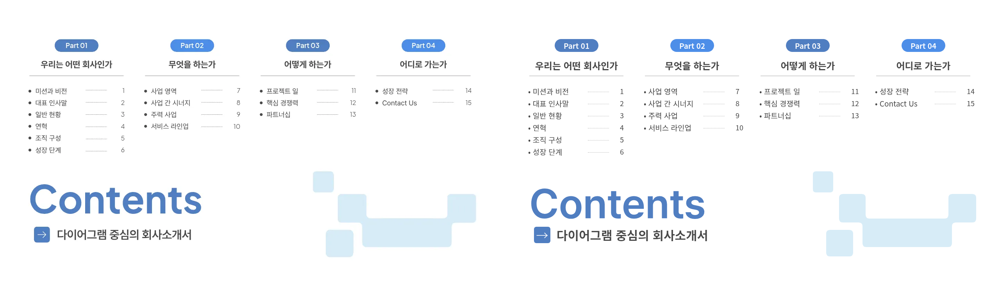

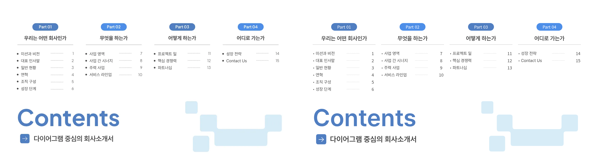

[재현 HTML](replica/slide_02.html) · [조립 HTML](reassembled/slide_02.html)

## slide_03

[재현 HTML](replica/slide_03.html) · [조립 HTML](reassembled/slide_03.html)

## slide_04

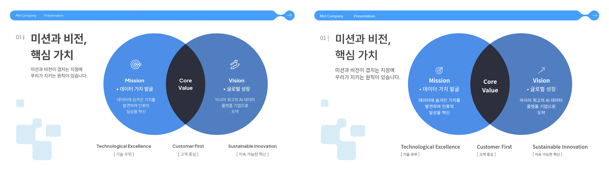

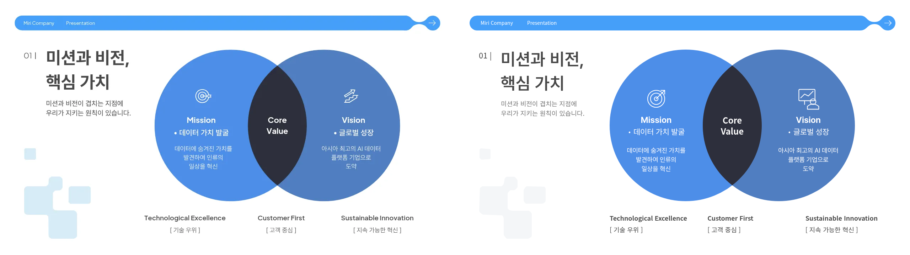

[재현 HTML](replica/slide_04.html) · [조립 HTML](reassembled/slide_04.html)

## slide_05

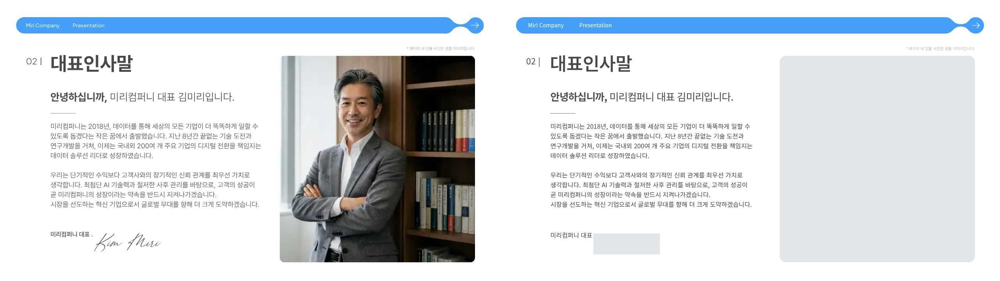

[재현 HTML](replica/slide_05.html) · [조립 HTML](reassembled/slide_05.html)

## slide_06

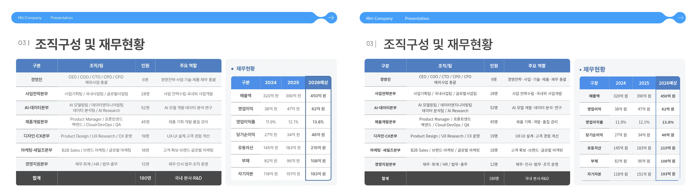

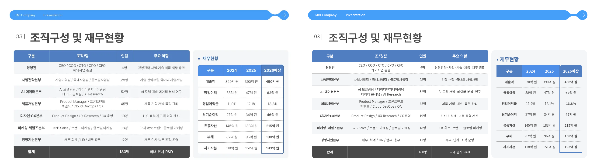

[재현 HTML](replica/slide_06.html) · [조립 HTML](reassembled/slide_06.html)

## slide_07

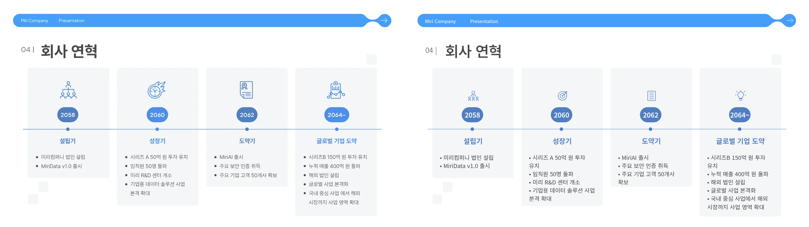

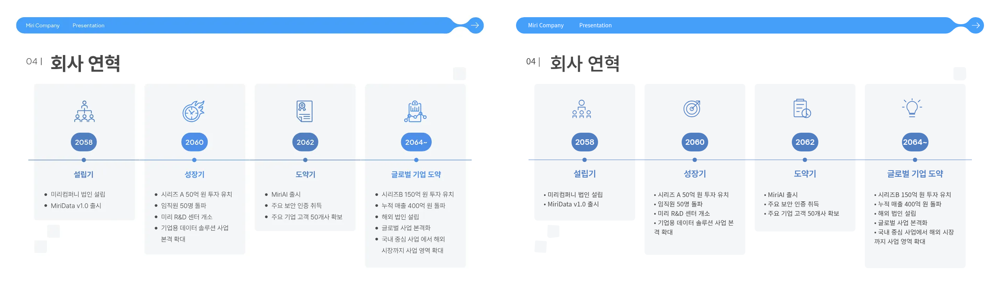

[재현 HTML](replica/slide_07.html) · [조립 HTML](reassembled/slide_07.html)

## slide_08

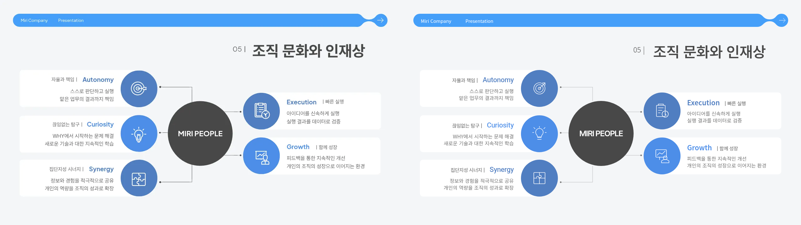

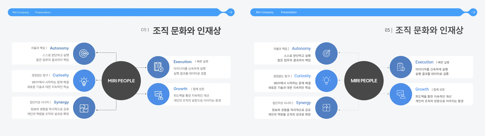

[재현 HTML](replica/slide_08.html) · [조립 HTML](reassembled/slide_08.html)

## slide_09

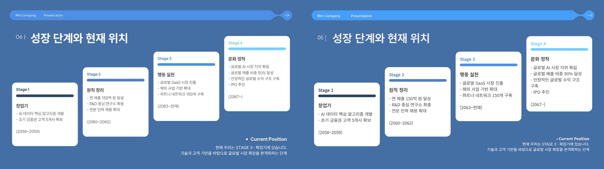

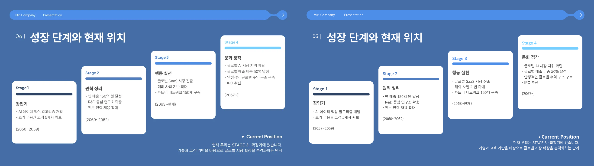

[재현 HTML](replica/slide_09.html) · [조립 HTML](reassembled/slide_09.html)

## slide_10

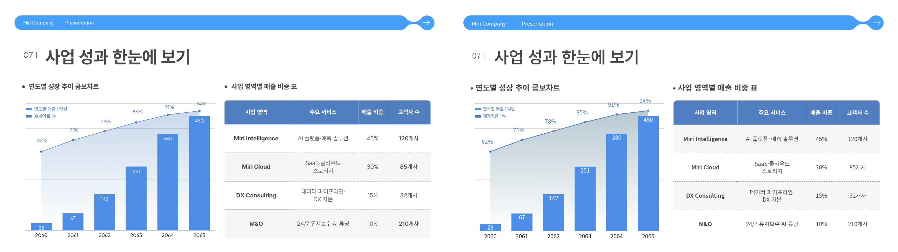

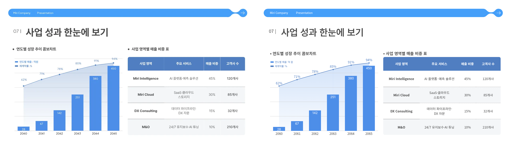

[재현 HTML](replica/slide_10.html) · [조립 HTML](reassembled/slide_10.html)

## slide_11

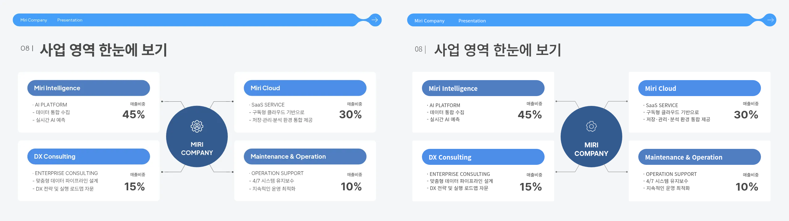

[재현 HTML](replica/slide_11.html) · [조립 HTML](reassembled/slide_11.html)

## slide_12

[재현 HTML](replica/slide_12.html) · [조립 HTML](reassembled/slide_12.html)

## slide_13

[재현 HTML](replica/slide_13.html) · [조립 HTML](reassembled/slide_13.html)

## slide_14

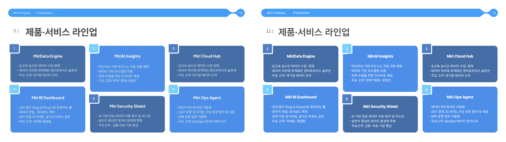

[재현 HTML](replica/slide_14.html) · [조립 HTML](reassembled/slide_14.html)

## slide_15

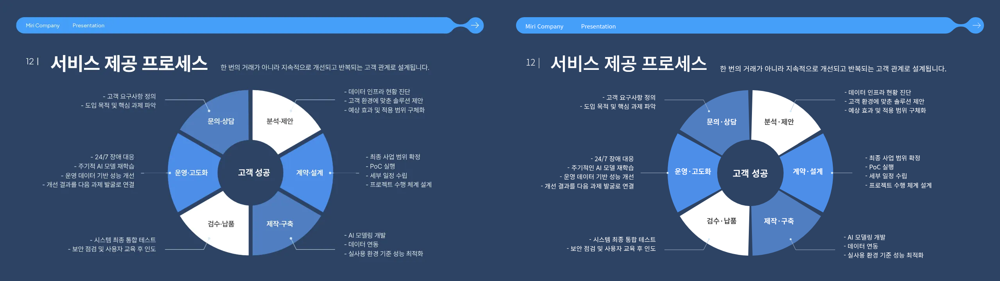

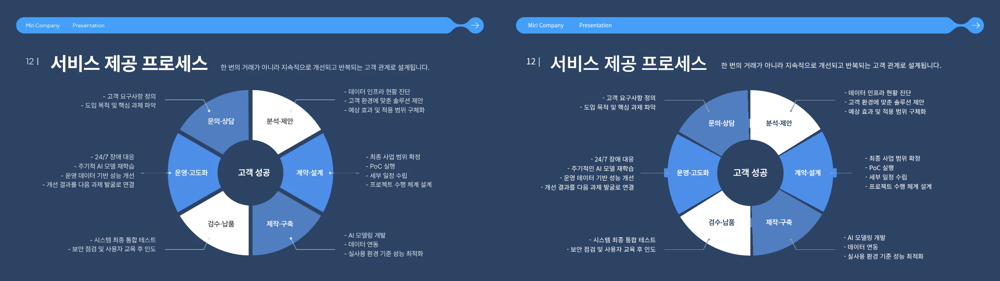

[재현 HTML](replica/slide_15.html) · [조립 HTML](reassembled/slide_15.html)

## slide_16

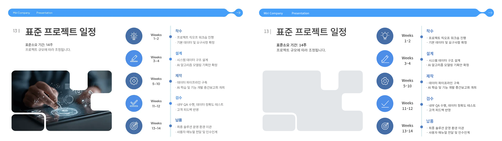

[재현 HTML](replica/slide_16.html) · [조립 HTML](reassembled/slide_16.html)

## slide_17

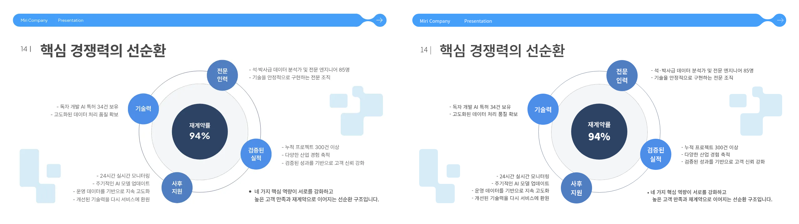

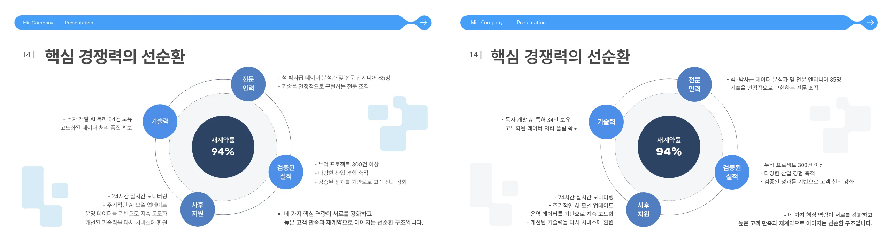

[재현 HTML](replica/slide_17.html) · [조립 HTML](reassembled/slide_17.html)

## slide_18

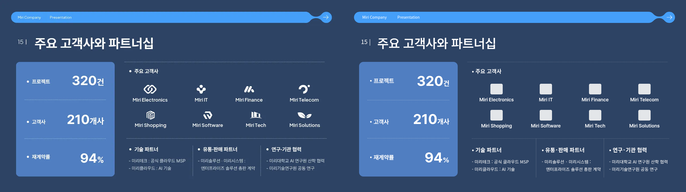

[재현 HTML](replica/slide_18.html) · [조립 HTML](reassembled/slide_18.html)

## slide_19

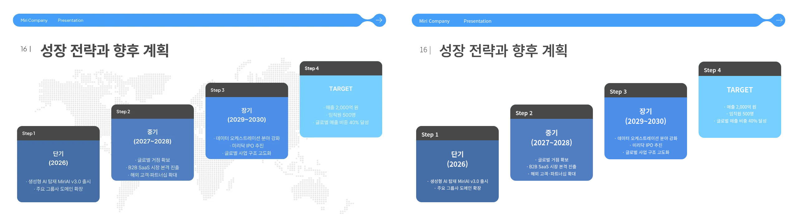

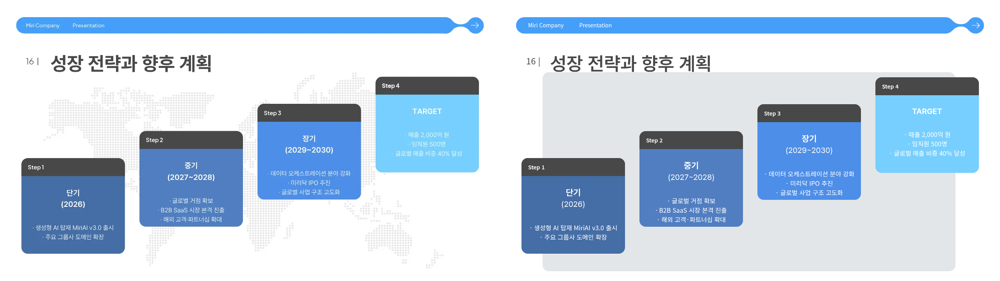

[재현 HTML](replica/slide_19.html) · [조립 HTML](reassembled/slide_19.html)

## slide_20

[재현 HTML](replica/slide_20.html) · [조립 HTML](reassembled/slide_20.html)
