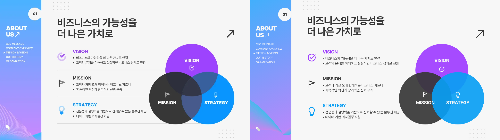
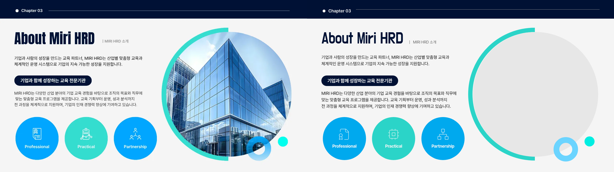
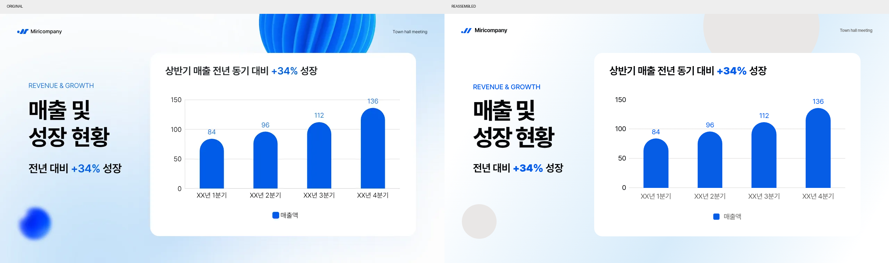
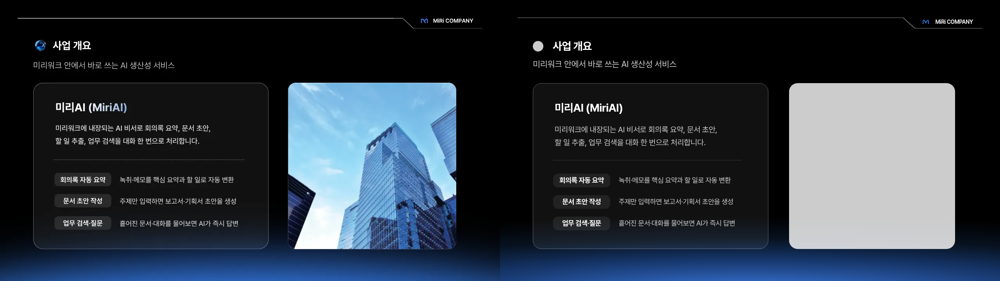
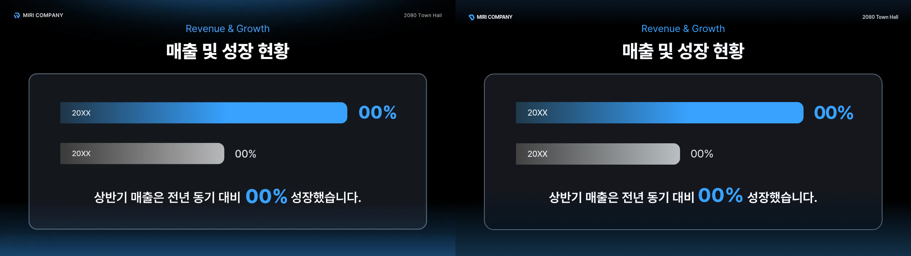

# Rhetis 디자인 컬렉션 5종

원본 96장으로부터 만든 별도 컬렉션 5종입니다. 각 컬렉션은 kit, foundation, 계약 요소 56개를 포함합니다.

| 덱 | 원본 장수 | 반입용 ZIP | 검수 ZIP | 소스 |
|---|---:|---|---|---|
| 002 기업소개서 | 18 | [fluxweave.zip](fluxweave.zip) | [검수 ZIP](fluxweave-review.zip) | [컬렉션 소스](fluxweave/) · [검수 소스](fluxweave-review/) |
| 003 교육 자료 | 18 | [cyanloop.zip](cyanloop.zip) | [검수 ZIP](cyanloop-review.zip) | [컬렉션 소스](cyanloop/) · [검수 소스](cyanloop-review/) |
| 004 기업행사 안내 | 24 | [roundrise.zip](roundrise.zip) | [검수 ZIP](roundrise-review.zip) | [컬렉션 소스](roundrise/) · [검수 소스](roundrise-review/) |
| 005 사업 계획 | 18 | [nightchamfer.zip](nightchamfer.zip) | [검수 ZIP](nightchamfer-review.zip) | [컬렉션 소스](nightchamfer/) · [검수 소스](nightchamfer-review/) |
| 006 타운홀 | 18 | [glasspulse.zip](glasspulse.zip) | [검수 ZIP](glasspulse-review.zip) | [컬렉션 소스](glasspulse/) · [검수 소스](glasspulse-review/) |

[전체 이미지 목록과 계약 대응](inventory.md) · [검증 결과](validation/)

검수 ZIP에는 원본 재현 HTML·PNG·PDF, 원본 비교 이미지, 라이트·다크 요소 시트와 PDF, 컬렉션만으로 재조립한 페이지, 디자인 언어와 차이·결정 기록을 담았습니다. 사진·복잡한 3D·그래픽 배경은 요청에 따라 회색 자리로 대체했습니다. 나머지 차이는 각 검수 폴더의 review-notes.md에 기록했습니다.

## 최종 재조립 비교 미리보기

### 기업소개서 · fluxweave



### 교육 자료 · cyanloop



### 기업행사 안내 · roundrise



### 사업 계획 · nightchamfer



### 타운홀 · glasspulse



## 파일 검증

컬렉션 ZIP은 최상위 폴더 하나만 포함하고 CSS·JSON·MD·HTML만 담습니다. 페이지 PNG는 1280×720입니다. 비교 이미지와 요소별 시트의 크기는 validation/artifact-audit.json에 파일별로 기록했습니다. ZIP의 SHA-256 및 재다운로드 검증 결과는 verification.json을 참고하세요.

## 로컬 미리보기

브라우저 파일 접근 정책에 따라 이 폴더에서 로컬 HTTP 서버를 실행하고 review 폴더의 HTML을 여세요. 라이브러리 시트 재생성은 다음 명령으로 할 수 있습니다.

```sh
python reference/tools/preview.py fluxweave reference/contract/type-steps.json --out light.html
python reference/tools/preview.py fluxweave reference/contract/type-steps.json --dark --out dark.html
```

build/에는 작업에 사용한 생성·렌더·검수 스크립트를 보존했습니다. 스크립트의 /workspace 경로는 제작 환경을 기준으로 하므로 다른 환경에서는 해당 경로를 조정해야 합니다.


## 요소별 검수 PDF

[전체 285쪽 통합본과 컬렉션별 57쪽 PDF](element-review-pdfs/) — 요소마다 라이트·다크를 나란히 놓고, 요소별 책갈피를 추가했습니다.


## 원본·카피 슬라이드 비교 PDF

[전체 96쪽 통합본과 덱별 비교 PDF](slide-comparison-pdfs/) — 한 페이지 위쪽은 원본 | replica, 아래쪽은 원본 | 라이브러리 조립본입니다.


## 전체 컬렉션·복제본 코드 통합 ZIP

[통합 소스 ZIP 다운로드](rhetis-all-collections-source.zip) — 5개 컬렉션·280요소·replica96장·라이브러리 조립96장의 코드와 폰트·아이콘·계약·미리보기 도구를 포함합니다. 압축 해제 후 README와 index.html로 시작하세요. [패키지 검증](source-bundle-verification.json)도 확인할 수 있습니다.
