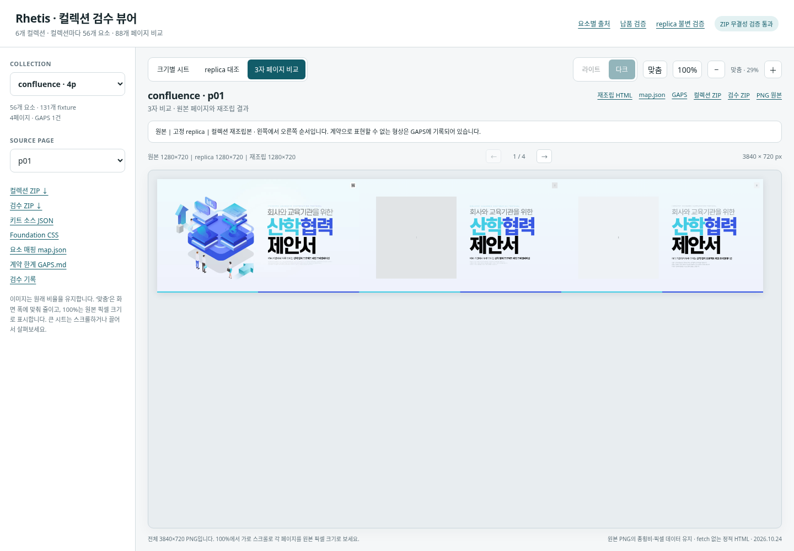

# Rhetis component rebuild · 2026-10-24

6개 덱을 각각 하나의 컬렉션으로 다시 설계했습니다. 각 컬렉션은 56개 계약 요소, 키트와 페이지 foundation을 포함합니다. 총 88개 페이지의 원본·고정 replica·재조립 결과를 비교할 수 있습니다.

[정적 검수 뷰어 소스](preview.html) · [요소별 replica 출처](element-origins.md) · [납품 검증 결과](delivery-validation.json) · [GitHub 재다운로드 검증](github-download-verification.json) · [replica 불변 검증](replica-freeze-validation.json)

| 컬렉션 | 페이지 | 컬렉션 ZIP | 검수 ZIP | 소스 | 계약 한계 |
|---|---:|---|---|---|---|
| nocturne | 6 (원본 p19–24) | [nocturne.zip](https://raw.githubusercontent.com/tommi0503/skills-introduction-to-github/rhetis-component-rebuild-20261024/rhetis-component-rebuild-20261024/nocturne.zip) | [nocturne-review.zip](https://media.githubusercontent.com/media/tommi0503/skills-introduction-to-github/rhetis-component-rebuild-20261024/rhetis-component-rebuild-20261024/nocturne-review.zip) | [키트](collections/nocturne/kit/kit.json) · [요소 소스](collections/nocturne/elements/) | [GAPS](reviews/nocturne/GAPS.md) |
| inflexion | 20 | [inflexion.zip](https://raw.githubusercontent.com/tommi0503/skills-introduction-to-github/rhetis-component-rebuild-20261024/rhetis-component-rebuild-20261024/inflexion.zip) | [inflexion-review.zip](https://media.githubusercontent.com/media/tommi0503/skills-introduction-to-github/rhetis-component-rebuild-20261024/rhetis-component-rebuild-20261024/inflexion-review.zip) | [키트](collections/inflexion/kit/kit.json) · [요소 소스](collections/inflexion/elements/) | [GAPS](reviews/inflexion/GAPS.md) |
| diecut | 19 | [diecut.zip](https://raw.githubusercontent.com/tommi0503/skills-introduction-to-github/rhetis-component-rebuild-20261024/rhetis-component-rebuild-20261024/diecut.zip) | [diecut-review.zip](https://raw.githubusercontent.com/tommi0503/skills-introduction-to-github/rhetis-component-rebuild-20261024/rhetis-component-rebuild-20261024/diecut-review.zip) | [키트](collections/diecut/kit/kit.json) · [요소 소스](collections/diecut/elements/) | [GAPS](reviews/diecut/GAPS.md) |
| afterglow | 9 | [afterglow.zip](https://raw.githubusercontent.com/tommi0503/skills-introduction-to-github/rhetis-component-rebuild-20261024/rhetis-component-rebuild-20261024/afterglow.zip) | [afterglow-review.zip](https://raw.githubusercontent.com/tommi0503/skills-introduction-to-github/rhetis-component-rebuild-20261024/rhetis-component-rebuild-20261024/afterglow-review.zip) | [키트](collections/afterglow/kit/kit.json) · [요소 소스](collections/afterglow/elements/) | [GAPS](reviews/afterglow/GAPS.md) |
| dockside | 30 | [dockside.zip](https://raw.githubusercontent.com/tommi0503/skills-introduction-to-github/rhetis-component-rebuild-20261024/rhetis-component-rebuild-20261024/dockside.zip) | [dockside-review.zip](https://media.githubusercontent.com/media/tommi0503/skills-introduction-to-github/rhetis-component-rebuild-20261024/rhetis-component-rebuild-20261024/dockside-review.zip) | [키트](collections/dockside/kit/kit.json) · [요소 소스](collections/dockside/elements/) | [GAPS](reviews/dockside/GAPS.md) |
| confluence | 4 | [confluence.zip](https://raw.githubusercontent.com/tommi0503/skills-introduction-to-github/rhetis-component-rebuild-20261024/rhetis-component-rebuild-20261024/confluence.zip) | [confluence-review.zip](https://raw.githubusercontent.com/tommi0503/skills-introduction-to-github/rhetis-component-rebuild-20261024/rhetis-component-rebuild-20261024/confluence-review.zip) | [키트](collections/confluence/kit/kit.json) · [요소 소스](collections/confluence/elements/) | [GAPS](reviews/confluence/GAPS.md) |

컬렉션 ZIP은 해당 컬렉션 이름의 최상위 폴더 하나만 포함합니다. 검수 ZIP에는 매핑, 크기별 라이트·다크 시트, replica 요소 대조와 페이지 비교 자료가 들어 있습니다. 파일별 SHA-256과 ZIP 무결성 결과는 `delivery-validation.json`에 기록합니다.

`preview.html`은 CSS·JavaScript·목록 데이터를 모두 포함하며 `fetch`를 사용하지 않습니다. 전체 소스 폴더를 같은 구조로 내려받아 파일을 직접 열어도 동작합니다. 검수 ZIP만 받은 경우에는 `<name>-review/`의 내용을 `reviews/<name>/`에 놓아 미리보기와 같은 상위 폴더 구조를 유지합니다. 컬렉션과 요소 또는 페이지를 고른 뒤 크기별 시트, replica 대조, 3자 비교 탭을 전환할 수 있습니다. 라이트·다크 전환은 크기별 시트에 적용됩니다. ‘맞춤’은 원본보다 커지지 않게 화면 폭에 맞추며, 100%는 원본 픽셀 크기를 보존합니다. 큰 시트와 3840×720 비교 이미지는 스크롤하거나 끌어서 검토할 수 있습니다.

기존 replica 191개 파일은 변경하지 않았습니다. 요소의 base와 계약 변형이 어느 replica 페이지에서 나왔는지는 `element-origins.md`와 각 컬렉션의 `reviews/<name>/map.json`에 남겼습니다. 원본에 없는 요소는 해당 덱에서 측정한 디자인 언어로 새로 설계했습니다. 각 요소의 출처 버튼과 fixture·CSS·계약 JSON 링크도 뷰어에서 열 수 있습니다.

계약이 허용하지 않는 형태를 임의의 전용 클래스나 데이터 토큰으로 흉내 내지 않았습니다. 표현할 수 없는 형상과 추가 계약 마크업 제안은 각 `GAPS.md`에 기록했습니다. 따라서 재조립본은 원본과 완전히 같다고 주장하지 않습니다. 이 차이와 원래 계약의 한계를 함께 검토할 수 있도록 3자 비교와 GAPS 링크를 제공합니다.

미리보기를 다시 생성하려면 패키징 뒤 `python tools/build_preview.py --root .`를 실행합니다. 작업공간 초안에서는 `--serve`를 붙이면 최종 `reviews/<name>/...` URL을 작업공간의 검수 자료로 읽기 전용 연결합니다. 최종 배포 HTML에는 서버나 외부 스크립트가 필요하지 않습니다.

전체 unexpressible 목록: [gap-index.md](gap-index.md). 기존 replica는 이전 `rhetis-six-collections-fidelity-20261023` 폴더에 보존되어 있습니다.
