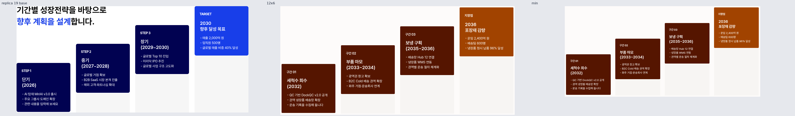
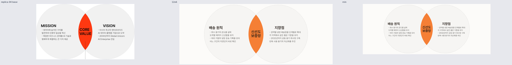
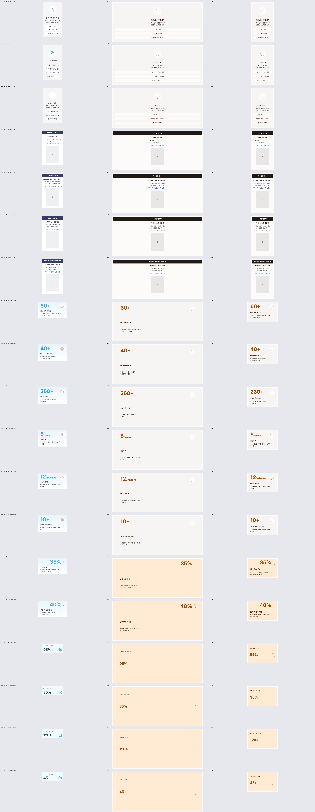
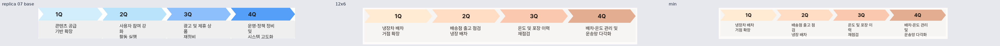
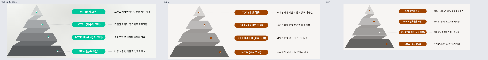
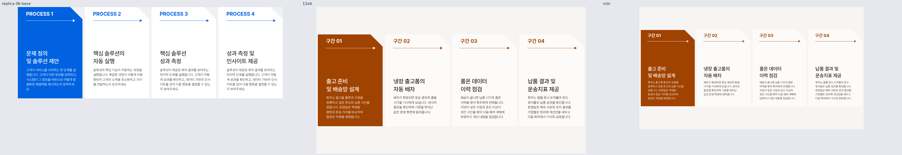

# 요소 재작성 미리보기

왼쪽은 동결한 replica HTML 조각, 가운데는 새 fixture의 12×6, 오른쪽은 최소 칸입니다. 원문 색은 계약 팔레트의 역할로 바뀌며 fixture 문구는 새로 작성했습니다. 전체 크기·테마는 각 컬렉션 검수 자료에서 확인하세요.

## 053 · rise-block · 19의 계단형 일정

[전체 시트](rise-block-review/index.html) · [출처](rise-block-review/PROVENANCE.md) · [계약 미지원](rise-block-review/GAPS.md)

## 054 · cinder-pulse · 04의 겹치는 원

[전체 시트](cinder-pulse-review/index.html) · [출처](cinder-pulse-review/PROVENANCE.md) · [계약 미지원](cinder-pulse-review/GAPS.md)

## 055 · current-fold · 10·11·15·16의 카드 계열

[전체 시트](current-fold-review/index.html) · [출처](current-fold-review/PROVENANCE.md) · [계약 미지원](current-fold-review/GAPS.md)

## 056 · scanline-rise · 07의 분기별 일정

[전체 시트](scanline-rise-review/index.html) · [출처](scanline-rise-review/PROVENANCE.md) · [계약 미지원](scanline-rise-review/GAPS.md)

## 058 · halo-field · 08의 접힌 계층

[전체 시트](halo-field-review/index.html) · [출처](halo-field-review/PROVENANCE.md) · [계약 미지원](halo-field-review/GAPS.md)

## 067 · corner-signal · 06의 노치 단계 카드

[전체 시트](corner-signal-review/index.html) · [출처](corner-signal-review/PROVENANCE.md) · [계약 미지원](corner-signal-review/GAPS.md)

## 069 · anchor-frame · 01의 그림 프레임

[전체 시트](anchor-frame-review/index.html) · [출처](anchor-frame-review/PROVENANCE.md) · [계약 미지원](anchor-frame-review/GAPS.md)

전체95장 조립 비교와14개ZIP: [탐색 화면](index.html) · [컬렉션 다운로드](README.md) · [unexpressible103개](UNEXPRESSIBLE.md).
