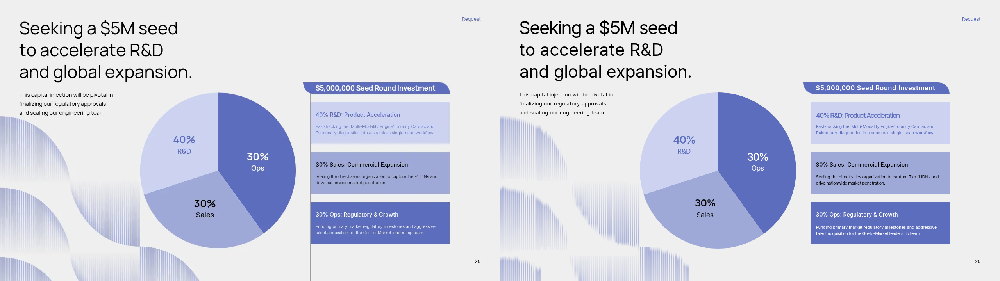

# Request 페이지 교정 중간본 — 완료본 아님

기존 원본→조립본 비교는 원본의 큰 3분할 파이를 세 개의 도넛으로 바꾸고 제목·설명·패널·배경의 배치를 재해석했다. 이 결과는 원본 재현으로 인정할 수 없어 완료 판정을 취소했다.

이 폴더는 원본 028 덱의 20쪽만 원본 좌표와 구성으로 다시 만든 **replica 중간 교정본**이다. 최종 컬렉션/조립본/검수 ZIP이 아니다. 최종 제출물은 별도 제작·검수 대상이다.

- 큰 3분할 파이 1개(400×400), 세 구역 안의 라벨, 오른쪽 3개 색면, 투자금 띠를 복원했다.
- 제목과 설명의 원본 줄바꿈을 보존하고 실제 잉크 경계를 측정해 배치했다. 작은 문구를 생략하거나 선으로 대체하지 않았다.
- 텍스트는 실제 로드한 Pretendard Variable, 파이는 CSS conic-gradient, 배경은 반복 선과 투명도 gradient의 SVG 도형이다. 원본 PNG를 replica 배경으로 사용하지 않았다.
- **잔여 차이:** 원본 폰트명은 미확정이다. 글리프·획·일부 baseline 및 배경 선의 굵기·농도·연속성이 일치하지 않는다. 100% 동일하다고 판정하지 않는다.
- 원본 파이의 면적은 시계방향 40/30/30이지만 내부 라벨은 Ops30/Sales30/R&D40으로 배치되어 있다. 임의 수정하지 않고 원본을 보존했다.

`python -m http.server 8000`으로 이 폴더를 제공한 뒤 `/replica/slide_20.html`을 1280×720 뷰포트로 열면 된다. PNG는 그 HTML을 Chromium에서 렌더한 결과다.

## 재작업 순서

1. 7개 덱, 87쪽 replica를 원본과 개별 비교해 먼저 바로잡는다.
2. 원본의 형태·배치·타이포를 다른 차트나 레이아웃으로 바꾸지 않는다.
3. 검토한 replica에서만 요소를 추출한다.
4. 파이 요소 부재·타입 단계 상한·실제 글꼴 부재처럼 계약이 동일한 표현을 담지 못하면 차이를 숨기지 않고 계약 확장 여부를 결정한다.
