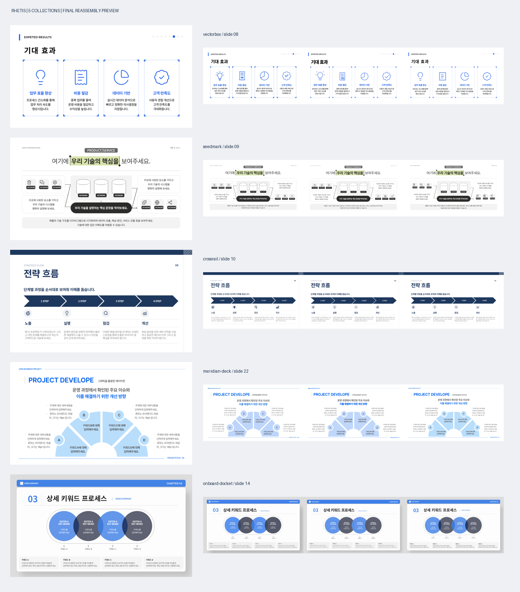

# Rhetis: 기업 프레젠테이션 069–078

각 덱을 독립 컬렉션으로 제작했습니다. 전체 5개 컬렉션, 원본 112장, 컬렉션별 foundation과 56개 요소입니다.

[대화형 미리보기 HTML](index.html) · [다운로드/무결성 명세](archive-manifest.json) · [게시 후 재다운로드 검증](github-download-verification.json)

| 덱 | 컬렉션 | 페이지 | 디자인 문법 | 다운로드 |
|---|---|---:|---|---|
| 069 | [vectorbox](vectorbox-project/vectorbox/) | 12 | 선택 상자와 모서리 핸들 | [컬렉션 ZIP](downloads/vectorbox.zip) · [검수 ZIP](downloads/vectorbox-review.zip) |
| 072 | [seedmark](seedmark-project/seedmark/) | 21 | 구절 하이라이트와 끝점 | [컬렉션 ZIP](downloads/seedmark.zip) · [검수 ZIP](downloads/seedmark-review.zip) |
| 073 | [crossrail](crossrail-project/crossrail/) | 30 | 네이비 레일과 교차선 | [컬렉션 ZIP](downloads/crossrail.zip) · [검수 ZIP](downloads/crossrail-review.zip) |
| 074 | [meridian-deck](meridian-deck-project/meridian-deck/) | 30 | 가는 프레임과 원형 배지 | [컬렉션 ZIP](downloads/meridian-deck.zip) · [검수 ZIP](downloads/meridian-deck-review.zip) |
| 078 | [onboard-docket](onboard-docket-project/onboard-docket/) | 19 | 바인더 띠와 번호 칩 | [컬렉션 ZIP](downloads/onboard-docket.zip) · [검수 ZIP](downloads/onboard-docket-review.zip) |

각 검수 ZIP에는 replica HTML·PNG·PDF, 원본 비교 PNG, 요소별 라이트·다크 PNG와 전체 PDF, 재조립 소스·PNG·PDF, 디자인 언어와 검수 기록이 들어 있습니다. 글꼴과 컬렉션 소스도 포함해 압축을 푼 뒤 로컬 HTTP 서버로 열 수 있습니다.

페이지 PNG는 1280×720, 좌우 비교 PNG는 2560×720입니다. 요소별 시트 PNG는 fixture 수에 따라 높이가 다르며, 실제 크기는 각 build-verification.json에 전부 기록했습니다.

검증 범위: 로컬 정적 계약 검사, Chromium 렌더링, 최소·중간·12×6 칸 검사, 글꼴/리소스·대비·정렬 검사, ZIP CRC 및 SHA-256 확인. 레퍼런스 팩에는 Rhetis 반입 엔진이 없어 upstream intake 실행은 포함하지 않습니다.

계약 해석: 필수 card-4 fixture의 원문 문자 아이콘은 동일 마크업·데이터 요구를 우선해 보존했습니다. 새 아이콘은 data-icon 방식입니다. 모범 fixture의 배치 값도 보존하고, 그 외 fixture의 최상위 배치는 12×6으로 정규화했습니다. 원본의 사진/복잡한 그래픽은 회색 placeholder이며, 판독이 어려운 문구와 시각적 차이는 컬렉션별 review-notes.md에 기록했습니다.

**충실도 한계:** 원본 100% 픽셀 동일로 인증하지 않습니다. 허용한 미디어 대체 외에도 일부 조립본의 겹침 깊이·선 두께·본문 줄바꿈·수 px 위치 차이가 남아 있습니다. [페이지별 최종 비교 기록](fidelity-review.md)을 함께 확인하세요.
