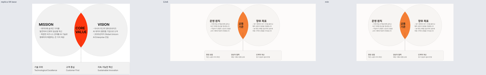
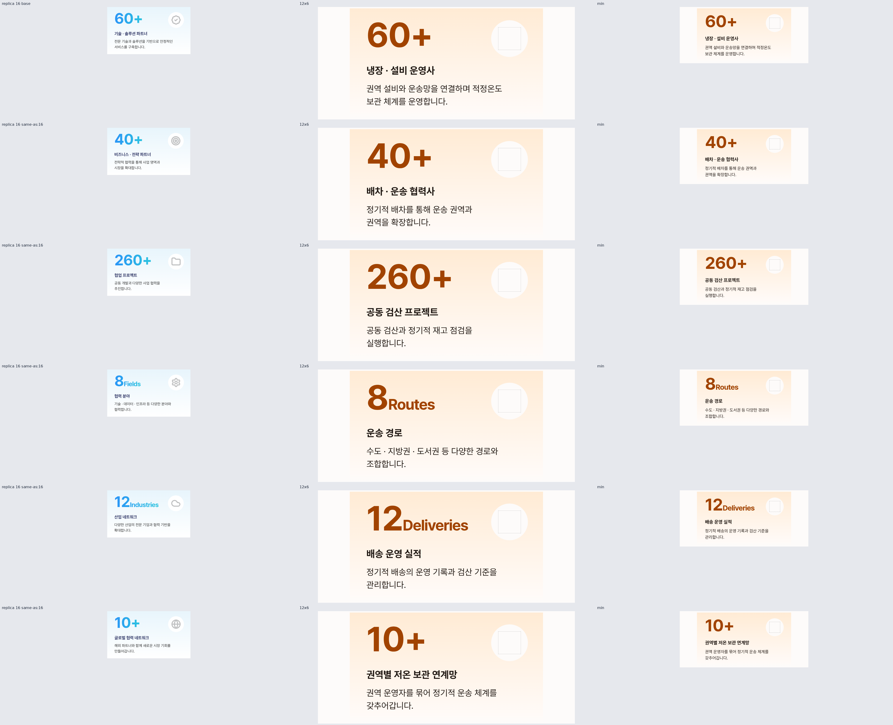
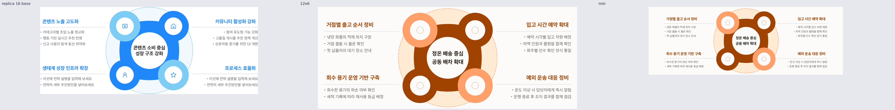
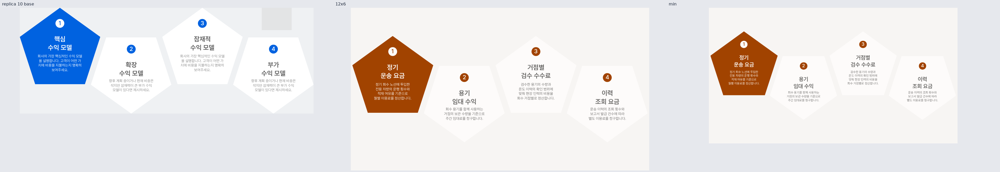
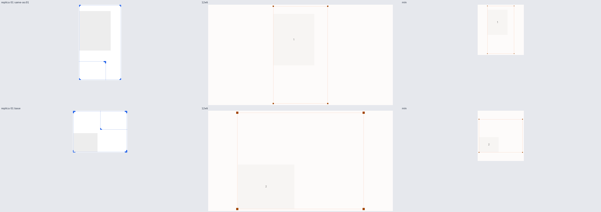

# Round 5 대표 비교

왼쪽 replica 조각, 가운데 새 fixture의12×6, 오른쪽 최소 칸입니다. 전체 크기·테마와 각 폴더의 출처는 아래 링크에서 확인합니다.

## 053 · rise-block

[전체 시트](rise-block-review/index.html) · [폴더 ← replica](rise-block-review/PROVENANCE.md) · [검수](rise-block-review/review-notes.md)

## 054 · cinder-pulse

[전체 시트](cinder-pulse-review/index.html) · [폴더 ← replica](cinder-pulse-review/PROVENANCE.md) · [검수](cinder-pulse-review/review-notes.md)

## 055 · current-fold

[전체 시트](current-fold-review/index.html) · [폴더 ← replica](current-fold-review/PROVENANCE.md) · [검수](current-fold-review/review-notes.md)

## 056 · scanline-rise

[전체 시트](scanline-rise-review/index.html) · [폴더 ← replica](scanline-rise-review/PROVENANCE.md) · [검수](scanline-rise-review/review-notes.md)

## 058 · halo-field

[전체 시트](halo-field-review/index.html) · [폴더 ← replica](halo-field-review/PROVENANCE.md) · [검수](halo-field-review/review-notes.md)

## 067 · corner-signal

[전체 시트](corner-signal-review/index.html) · [폴더 ← replica](corner-signal-review/PROVENANCE.md) · [검수](corner-signal-review/review-notes.md)

## 069 · anchor-frame

[전체 시트](anchor-frame-review/index.html) · [폴더 ← replica](anchor-frame-review/PROVENANCE.md) · [검수](anchor-frame-review/review-notes.md)

