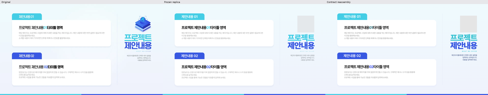
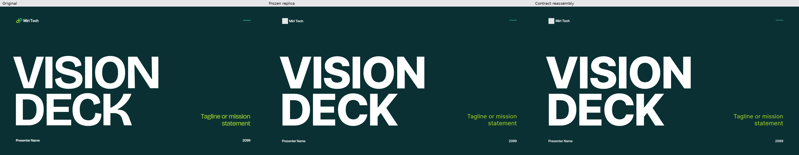
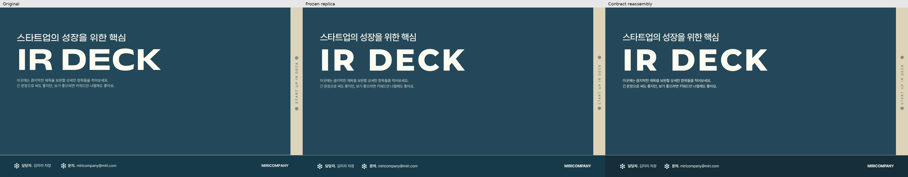
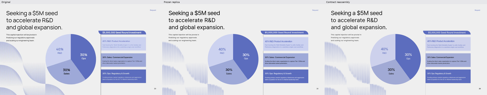
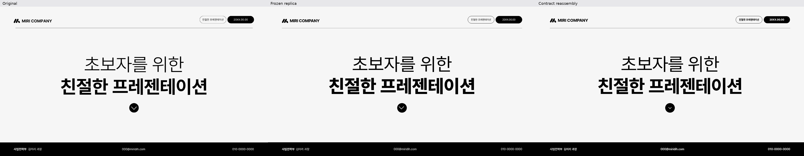

# Rhetis round5

[이미지·PDF 없는 전체 소스 ZIP](downloads/rhetis-020-030-source.zip)

7개 덱별 소스·다운로드·크기별 시트·조립 대조입니다. 원본 replica는 보존했습니다.

| 컬렉션 | 다운로드 | 검수 |
|---|---|---|
| [tide-tab](tide-tab/) | [컬렉션 ZIP](downloads/tide-tab.zip) · [검수 ZIP](downloads/tide-tab-review.zip) | [라이트](review/tide-tab/light.html) · [다크](review/tide-tab/dark.html) · [요소 시트](review/tide-tab/sheets/) · [조립 비교](review/tide-tab/compare-reassembled/) · [검수기록](review/tide-tab/review-notes.md) |
| [cutfield](cutfield/) | [컬렉션 ZIP](downloads/cutfield.zip) · [검수 ZIP](downloads/cutfield-review.zip) | [라이트](review/cutfield/light.html) · [다크](review/cutfield/dark.html) · [요소 시트](review/cutfield/sheets/) · [조립 비교](review/cutfield/compare-reassembled/) · [검수기록](review/cutfield/review-notes.md) |
| [filament](filament/) | [컬렉션 ZIP](downloads/filament.zip) · [검수 ZIP](downloads/filament-review.zip) | [라이트](review/filament/light.html) · [다크](review/filament/dark.html) · [요소 시트](review/filament/sheets/) · [조립 비교](review/filament/compare-reassembled/) · [검수기록](review/filament/review-notes.md) |
| [portico](portico/) | [컬렉션 ZIP](downloads/portico.zip) · [검수 ZIP](downloads/portico-review.zip) | [라이트](review/portico/light.html) · [다크](review/portico/dark.html) · [요소 시트](review/portico/sheets/) · [조립 비교](review/portico/compare-reassembled/) · [검수기록](review/portico/review-notes.md) |
| [toggle-grid](toggle-grid/) | [컬렉션 ZIP](downloads/toggle-grid.zip) · [검수 ZIP](downloads/toggle-grid-review.zip) | [라이트](review/toggle-grid/light.html) · [다크](review/toggle-grid/dark.html) · [요소 시트](review/toggle-grid/sheets/) · [조립 비교](review/toggle-grid/compare-reassembled/) · [검수기록](review/toggle-grid/review-notes.md) |
| [lamella](lamella/) | [컬렉션 ZIP](downloads/lamella.zip) · [검수 ZIP](https://codeload.github.com/tommi0503/skills-introduction-to-github/zip/73fc3662f1fe444bead8b8da525e8d24ad371b65) | [라이트](review/lamella/light.html) · [다크](review/lamella/dark.html) · [요소 시트](review/lamella/sheets/) · [조립 비교](review/lamella/compare-reassembled/) · [검수기록](review/lamella/review-notes.md) |
| [rulemark](rulemark/) | [컬렉션 ZIP](downloads/rulemark.zip) · [검수 ZIP](downloads/rulemark-review.zip) | [라이트](review/rulemark/light.html) · [다크](review/rulemark/dark.html) · [요소 시트](review/rulemark/sheets/) · [조립 비교](review/rulemark/compare-reassembled/) · [검수기록](review/rulemark/review-notes.md) |

## 검수 시트 PDF

- tide-tab: [library-dark](review/tide-tab/library-dark.pdf) · [library-light](review/tide-tab/library-light.pdf)
- cutfield: [library-dark](review/cutfield/library-dark.pdf) · [library-light](review/cutfield/library-light.pdf)
- filament: [library-dark](review/filament/library-dark.pdf) · [library-light](review/filament/library-light.pdf)
- portico: [library-dark](review/portico/library-dark.pdf) · [library-light](review/portico/library-light.pdf)
- toggle-grid: [library-dark](review/toggle-grid/library-dark.pdf) · [library-light](review/toggle-grid/library-light.pdf)
- lamella: [library-dark](review/lamella/library-dark.pdf) · [library-light](review/lamella/library-light.pdf)
- rulemark: [library-dark](review/rulemark/library-dark.pdf) · [library-light](review/rulemark/library-light.pdf)

Lamella 검수 ZIP은 GitHub의 데이터 전용 검수 커밋에서 내보낸 파일입니다. GitHub가 붙이는 바깥 폴더1개 안에 동일한 검수 파일이 들어 있습니다. 모든 멤버 SHA256을 대조했습니다.

### tide-tab

### cutfield

### filament

### portico

### toggle-grid

### lamella

### rulemark

